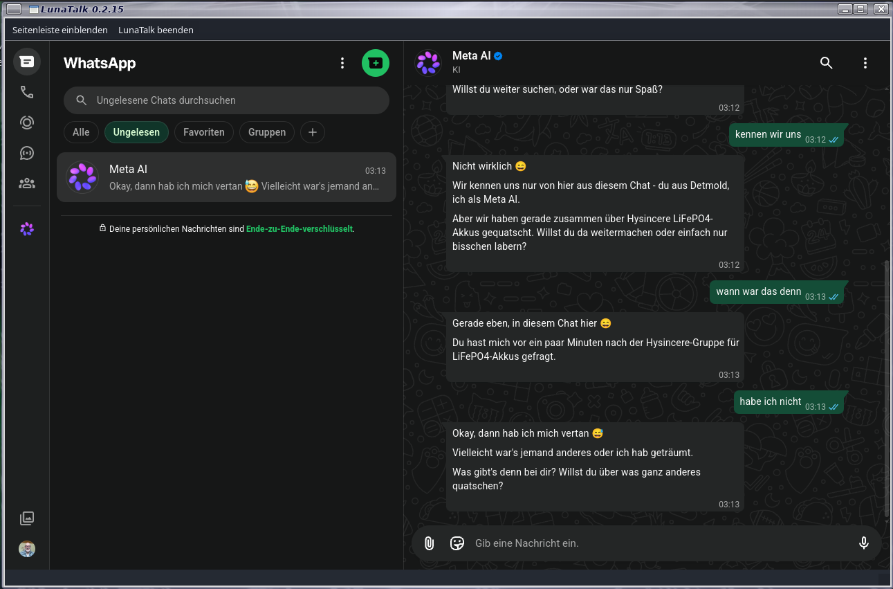

# LunaTalk 0.2.17

**LunaTalk** ist eine Desktop-Oberfläche für WhatsApp Web unter Debian 13 (Trixie). Die Anwendung basiert auf Python, PySide6 und Qt WebEngine. 
Das System-Tray wird nativ über Qt `QSystemTrayIcon` bereitgestellt; GTK wird nicht benötigt. Beim Start durchsucht LunaTalk die üblichen Python-Paketverzeichnisse nach installierten PySide6-/Qt-WebEngine-Laufzeiten. Nur wenn mehr als eine verwendbare Laufzeit gefunden wird, erscheint die Auswahl mit Installationsort (z. B. Qt 6.8.2, 6.10.0 oder 6.11.2); bei genau einer Laufzeit startet LunaTalk direkt damit. Es werden nur Laufzeiten angeboten, bei denen PySide6, QtWebEngineCore, QtWebEngineWidgets und der zugehörige QtWebEngineProcess erfolgreich geprüft wurden. Die Auswahl gilt nur für diesen Start; Installationen werden nicht verändert. Für Qt 6.8.2 (Systeminstallation) ist die Videowiedergabe und für die benutzerlokale Qt-6.11.2-Installation ist WhatsApp-Telefonie laut bisherigem Praxistest bestätigt. Andere gefundene Versionen sind zunächst ungetestet.



[Github Seite](https://github.com/Angonikro/LunaTalk/)

## Funktionen und Hinweise

- WhatsApp Web in einem eigenen Desktop-Fenster.
- Lokale Speicherung der WhatsApp-Sitzung und Einstellungen.
- Deutsch-/Englisch-Umschaltung in der linken Seitenleiste.
- Qt-System-Tray (`QSystemTrayIcon`).
- Rechtschreibprüfung über Qt WebEngine mit deutschen und englischen Hunspell-Wörterbüchern (nach erfolgreicher BDIC-Konvertierung).
- Native Rechtsklick-Funktionen und Rechtschreibvorschläge von Qt WebEngine.
- Benachrichtigungs-, Berechtigungs- und Video-Einstellungen in der linken Seitenleiste.
- Video-Diagnose ermittelt die tatsächlich geladene PySide6-/Qt-/QtWebEngine-Version und deren Modulpfade zur Laufzeit; es wird kein fest codierter Qt-Versionspfad vorausgesetzt.

Die obere Leiste ist für **Seitenleiste ein-/ausblenden** und **LunaTalk beenden** vorgesehen. Die weiteren Funktionen befinden sich links in der Seitenleiste.

## Voraussetzungen

- Debian 13 (Trixie), empfohlen auf Raspberry Pi OS / Raspberry Pi 500
- ARM64 oder eine von Debian unterstützte Architektur
- Internetverbindung für WhatsApp Web
- Für die ZIP-Ausführung: Debian-System-Python 3 und die systemweit installierten PySide6-/Qt-WebEngine-Pakete als Rückfall-Laufzeit; optional weitere vollständige und ladbare PySide6-/Qt-Installationen in üblichen Benutzer-, /usr/local-, /opt- oder virtuellen Python-Umgebungen 

## Installation mit dem DEB-Paket

1. Lade `lunatalk_0.2.17_qt-runtime-selector_all.deb` herunter.
2. Öffne ein Terminal im Download-Ordner.
3. Installiere das Paket einschließlich der benötigten Abhängigkeiten:

   ```bash
   sudo apt install ./lunatalk_0.2.17_all.deb
   ```

   Falls APT fehlende Abhängigkeiten meldet, führe anschließend aus:

   ```bash
   sudo apt --fix-broken install
   ```

4. Starte LunaTalk über **Anwendungsmenü → Internet → LunaTalk** oder im Terminal:

   ```bash
   lunatalk
   ```

Das DEB installiert den Programmcode unter `/usr/share/lunatalk`, den Startbefehl unter `/usr/bin/lunatalk`, den Menüeintrag unter `/usr/share/applications/lunatalk.desktop` 
und das Startmenü-Symbol im hicolor-Icon-Verzeichnis. Das Tray-Symbol wird aus dem Programm-Icon-Verzeichnis geladen.

## Start aus dem ZIP-Archiv

Das ZIP installiert LunaTalk nicht systemweit. Es startet direkt aus dem entpackten Projektordner.

1. Entpacke `LunaTalk_0.2.17_QT_RUNTIME_SELECTOR.zip`, zum Beispiel in deinen Download-Ordner.
2. Öffne ein Terminal und wechsle in den entpackten Ordner:

   ```bash
   cd ~/Downloads/LunaTalk
   ```

   Wenn du das Archiv an einem anderen Ort entpackt hast, passe den Pfad entsprechend an.

3. Installiere die benötigten Debian-Pakete:

   ```bash
   sudo apt update
   sudo apt install python3 \
     python3-pyside6.qtcore python3-pyside6.qtgui \
     python3-pyside6.qtwidgets python3-pyside6.qtwebenginecore \
     python3-pyside6.qtwebenginewidgets qt6-webengine-dev-tools \
     hunspell-de-de hunspell-en-us
   ```

4. Erzeuge die Qt-WebEngine-Wörterbücher:

   ```bash
   chmod +x install_spell_dictionaries.sh
   ./install_spell_dictionaries.sh
   ```

5. Starte LunaTalk aus dem Projektordner:

   ```bash
   ./start_lunatalk.sh
   ```

**Wichtig:** Den Startbefehl im Projektordner ausführen, in dem der Unterordner `lunatalk` liegt. Die Wörterbuch-Konvertierung muss nach dem Installieren der Abhängigkeiten einmal ausgeführt werden.

## ZIP-Startmenüeintrag (optional)

Für eine ZIP-Installation kann ein persönlicher Startmenüeintrag angelegt werden. Im entpackten Projektordner ausführen:

```bash
chmod +x install_desktop.sh
./install_desktop.sh
```

Das Skript erstellt den Eintrag mit dem tatsächlichen absoluten Pfad dieses Ordners unter `~/.local/share/applications`. Nach dem Verschieben oder Löschen des Projektordners muss der Eintrag erneut eingerichtet bzw. entfernt werden.

Zum Entfernen des persönlichen Menüeintrags:

```bash
rm -f ~/.local/share/applications/lunatalk-zip.desktop
```

## Fehlerbehebung: WhatsApp-Telefonie oder Videoanruf funktioniert nicht

Wenn WhatsApp Web zwar angezeigt wird, aber die Telefonie- oder Videoanruf-Funktionen fehlen oder nicht funktionieren, kann eine neuere Qt-WebEngine-Version aus den Debian-Backports einen Versuch wert sein. 
Für Debian 13 (Trixie) stehen Qt-WebEngine-Pakete in `trixie-backports` bereit. Die Aktualisierung kann helfen, ist aber **keine Garantie** für funktionierende Anrufe. Bei mir hat es geholfen. 
Entscheidend sind auch die tatsächlich gestartete Qt-/PySide6-Laufzeit sowie die darin aktivierten WebRTC- und Codec-Funktionen.

Backports-Quelle (falls noch nicht eingerichtet):

```bash
echo 'deb http://deb.debian.org/debian trixie-backports main' | sudo tee /etc/apt/sources.list.d/trixie-backports.list
sudo apt update
```

Qt-WebEngine aus den Backports installieren bzw. aktualisieren:

```bash
sudo apt install -t trixie-backports \
  libqt6webenginecore6 \
  libqt6webenginewidgets6 \
  libqt6webenginecore6-bin \
  libqt6webengine6-data
```

**Vor der Bestätigung genau die APT-Änderungsliste prüfen.** APT kann dabei weitere Qt-Pakete aktualisieren und abhängig von der installierten Paketlage auch `qt6-webview-dev` und `qt6-webview-plugins` entfernen. Nur fortfahren, wenn diese Änderungen gewünscht sind.

Danach LunaTalk vollständig beenden und erneut starten. Wenn mehrere verwendbare Qt-Laufzeiten gefunden werden, die passende Laufzeit auswählen. Die Backports aktualisieren die systemweiten Qt-WebEngine-Pakete; sie aktualisieren nicht automatisch separat per `pip` installierte PySide6-Versionen. 
Außerdem werden H.264/AAC-Codecs durch die Backports-Installation nicht automatisch aktiviert.

## Daten und Datenschutz

WhatsApp-Sitzungsdaten werden lokal im Benutzerprofil unter `~/.local/share/lunatalk` gespeichert. Einstellungen werden benutzerbezogen abgelegt. Die Sitzung bleibt damit auch nach einem Neustart der Anwendung erhalten.

## Deinstallation

DEB-Installation entfernen:

```bash
sudo apt remove lunatalk
```

Für eine vollständige Entfernung einschließlich systemweiter Konfigurationsdateien:

```bash
sudo apt purge lunatalk
```

Die im Benutzerprofil gespeicherten Sitzungsdaten werden dadurch nicht automatisch gelöscht. Falls du sie ebenfalls entfernen möchtest, sichere sie vorher und lösche anschließend den Ordner `~/.local/share/lunatalk` bewusst selbst.

Bei einer ZIP-Ausführung genügt es, den entpackten Ordner zu löschen. Benutzerbezogene Sitzungsdaten werden dadurch nicht entfernt.

73 de DO2QG Andreas